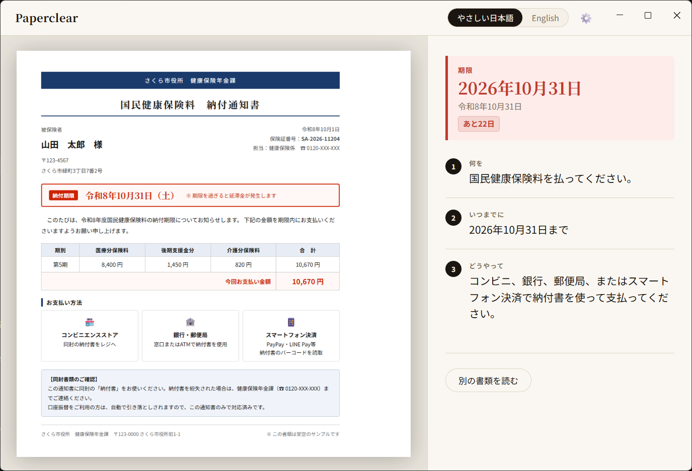
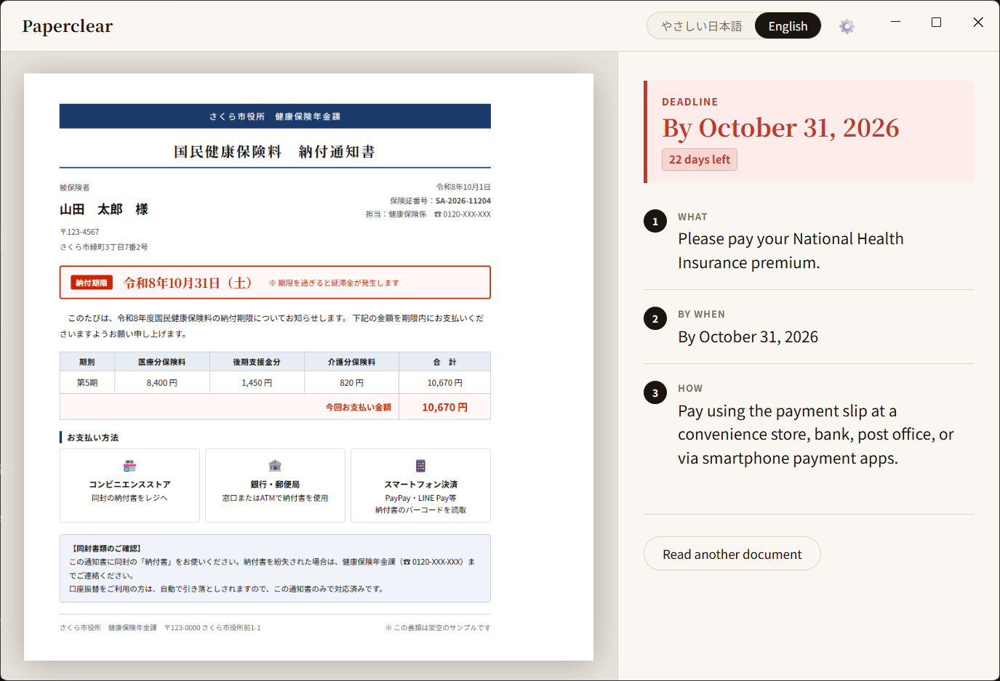

# Paperclear

**Paperclear — Turn confusing Japanese paperwork into 3 clear actions and a deadline.**

Foreign residents in Japan receive official documents they can't fully read. Paperclear takes a photo of the document and tells you exactly what to do, by when, and how — in plain Japanese or English.

---

## Screenshots

<table>
  <tr>
    <td align="center" width="50%">
      <br>
      <em>Plain Japanese — deadline converted from the Japanese era calendar</em>
    </td>
    <td align="center" width="50%">
      <br>
      <em>English — switches instantly, no re-read</em>
    </td>
  </tr>
</table>

---

## The Problem

Foreign residents in Japan regularly receive envelopes from city halls, schools, and government offices. The text is dense, formal Japanese — difficult even for fluent readers. The result is missed deadlines, incorrect submissions, and real anxiety. Adult children who help elderly parents remotely face the same problem from a distance.

Translation apps give you more text to read. Paperclear gives you a to-do.

---

## What It Does

1. **Drop a photo or use the in-app camera** to capture the document.
2. **Gemini AI reads the image** and extracts the deadline and three action steps.
3. The **deadline appears large** at the top of the screen — impossible to miss.
4. **Japanese era dates** (令和, 平成) are converted to Western calendar years automatically.
5. A **days-remaining badge** shows how much time is left; overdue documents show the number of days past the deadline.
6. **Toggle between やさしい日本語 and English** without re-scanning the document.

---

## Why It's Different

Translation tools give you the full text. Paperclear gives you three lines:

- **What** to do
- **By when**
- **How** to do it

The deadline is the largest element on screen, styled like a red stamp — unmissable.

---

## How to Run

**Requirements**

- [Node.js](https://nodejs.org/) 18 or later
- A [Gemini API key](https://aistudio.google.com/apikey) (free tier works)

**Install and start**

```bash
git clone https://github.com/lias6v60122/paperclear.git
cd paperclear
npm install
cp .env.example .env
# Open .env and replace "your_key_here" with your actual Gemini API key
npm start
```

Alternatively, skip the `.env` file — the app's setup screen on first launch will ask for the key directly and save it locally.

---

## Privacy Note

- Document images are sent to **Google's Gemini API** for reading. This app does not store or upload them anywhere else.
- With a **free-tier API key**, Google may use submitted content for product improvement. See [Google's Gemini API Terms of Service](https://ai.google.dev/gemini-api/terms) for details. If this is a concern, use a paid API key or avoid submitting documents with sensitive personal information.
- All documents used in development and demo are **entirely fictional**. No real personal data was used.
- Your API key is stored **on your local device only**, in a file excluded from this repository.

---

## Built With

- [Electron](https://www.electronjs.org/) — desktop application shell
- [Gemini API](https://ai.google.dev/) (`gemini-3.8-flash`, with `gemini-3.5-flash-lite` fallback) — document reading
- [Claude Code](https://claude.ai/code) — AI-assisted development
- [Devpost Learn Skill Pack](https://devpost.com/) — planning curriculum (scope → PRD → spec → build)

---

## Planning Docs

The full planning trail is in [`devpost/`](devpost/):

- [`scope.md`](devpost/scope.md) — project vision and POC boundary
- [`prd.md`](devpost/prd.md) — product requirements and screen descriptions
- [`spec.md`](devpost/spec.md) — technical specification

---

## Limitations

This is a proof-of-concept built for a hackathon. The AI may misread text, miss deadlines, or produce incorrect summaries.

**Always verify the output against the original document before taking any action.**

This tool does not provide legal, tax, or official administrative advice.

---

## License

MIT — see [LICENSE](LICENSE)
